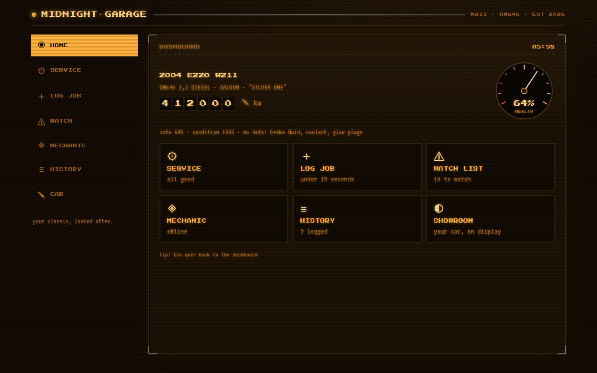
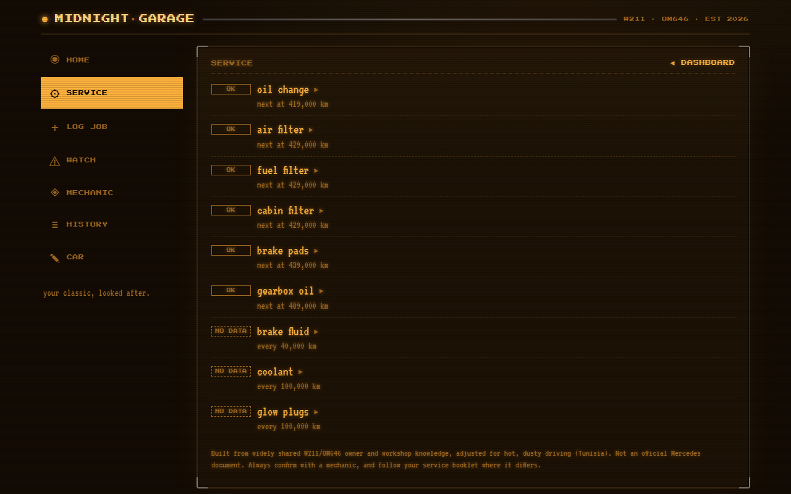
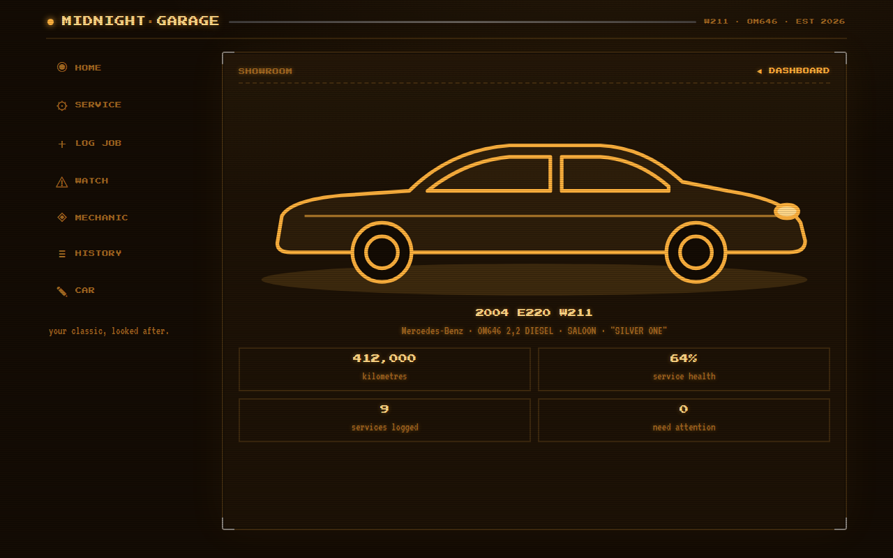
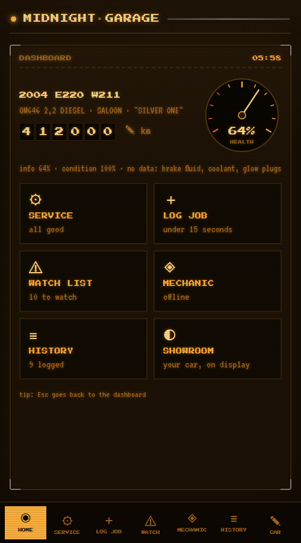

# Midnight Garage

A service log for my 2004 Mercedes W211 E 220 CDI (OM646 diesel, 412,000 km), with a "what's due" list, a watch list of known issues, an honest health score, and a local AI mechanic.

It's my first real project on the way to working with AI agents. I write the specs, make the decisions and review the work. Claude writes most of the code. I reviewed every milestone, and I can explain how each part works.



## What it does

- **Decode the VIN.** Paste your VIN and it fills in the model, engine and body. W211 only for now, one verified variant at a time.
- **Log a job in under 15 seconds.** Tap everything that was done (oil, filters, brake pads...), then add the mileage and save. Each service becomes its own entry.
- **What's due.** Every service is checked by kilometres **and** by time, whichever runs out first. Parts wear from driving, but brake fluid and coolant also age while the car sits parked.
- **Watch list.** 11 known W211 / OM646 problems (injector seals, timing chain, SBC brakes, EGR...) filtered to your mileage, with the signs to look for and what to check.
- **Health score.** One number for the whole car. See below.
- **AI mechanic.** Ask a quick question, or run a diagnosis session: describe the problem, answer 4 questions, get a ranked list of likely causes. It runs locally with [Ollama](https://ollama.com), so it's free and nothing leaves your PC.
- **Works on phone and desktop:** a side menu on desktop, a bottom tab bar on phone.

| What's due | Showroom | Phone |
|---|---|---|
|  |  |  |

## The health score

The first version said my car was **100% healthy**. It wasn't. It just ignored everything it had no data on: brake fluid, coolant, glow plugs.

So now:

- Each service has a **weight** for how much it matters: brakes and oil 3, coolant and fuel filter 2, air filter, gearbox oil and glow plugs 1, cabin filter 0.5. The weights live in the knowledge file, so you can change them without touching code.
- **Info %** = how much of the car the app actually knows about, weighted.
- **Condition %** = how healthy the services it *does* know about are. A service only starts losing points in the last 20% of its interval.
- **Health = condition × info.** Unknown services pull the score down until you log them.
- **Overdue brakes cap health at 60%**, however good everything else is.

My car: 64%. That's honest. Everything logged is fresh, but 3 things are unknown.

## Guardrails

The AI is useful, but it isn't reliable, so the important parts don't depend on it:

- **Safety warnings are added by code, not by the AI.** If brakes, steering or tyres come up (in English or French), the warning is always added.
- **Backup questions.** If the model returns the questions in the wrong format, the diagnosis falls back to 4 solid general questions instead of breaking.
- **Edits are checked.** Before changing or deleting an entry, the server checks it's still the entry you meant.
- **The odometer only goes up.** Logging an old job never rolls your mileage back.

## Run it

Needs Python 3. No extra packages.

```bash
python dashboard.py
```

It opens at `http://127.0.0.1:5211`.

For the AI mechanic, install [Ollama](https://ollama.com) and run `ollama pull llama3.2:3b`. Everything else works without it.

Your car details and service log are saved in `car.json` and `service_log.json` next to the script. They stay on your machine and are not part of this repo.

## Honest limits

- The knowledge base comes from widely shared W211 / OM646 owner and workshop knowledge, adjusted for hot, dusty driving. **It's not an official Mercedes document.** Check with your mechanic, and follow your service booklet where it disagrees.
- The local 3B model is decent, not brilliant. It sometimes repeats itself or misses obvious causes.
- One car so far. Adding a model means adding a knowledge file.

## Files

| File | What it does |
|---|---|
| `dashboard.py` | Small web server and API (state, jobs, edit, delete, VIN, AI) |
| `dashboard.html` | The whole interface |
| `knowledge.py` | What's due, watch list, health score |
| `knowledge/w211_om646.json` | Service intervals, weights, known issues: plain data you can edit |
| `mechanic.py` | AI mechanic: quick questions, diagnosis sessions, safety guardrail |
| `vin.py` | VIN decoder |
| `tracker.py` | Reads and writes the service log |

## Roadmap

- [x] Log services and show history
- [x] What's due, by km and by time
- [x] Watch list and AI mechanic
- [x] Honest health score and redesign
- [ ] More W211 engines, then other pre-2010 Mercedes and BMW

## The story

I'm writing about the build, mistakes included, on my blog: [midnightbluelog.github.io](https://midnightbluelog.github.io)

*by midnightblue · not affiliated with Mercedes-Benz*
